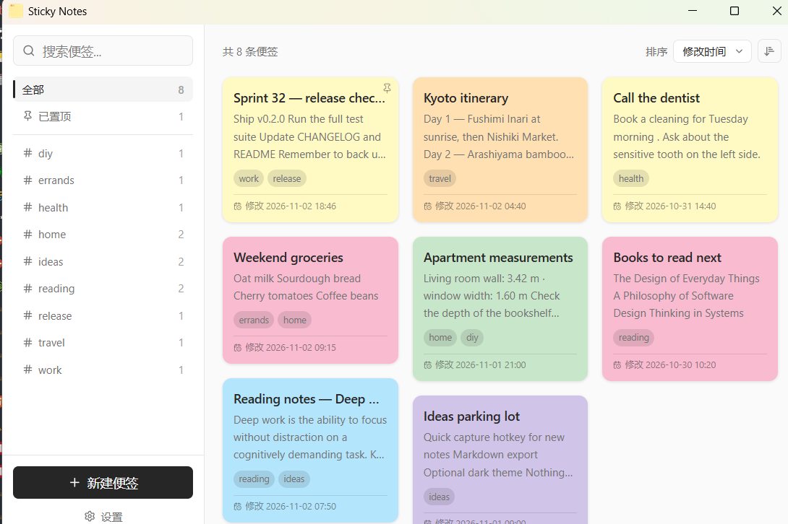
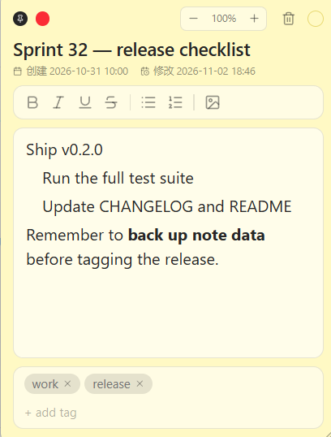
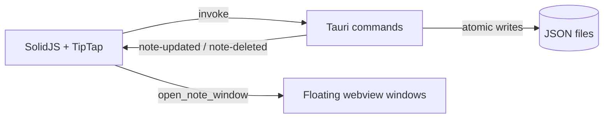

<div align="center">

# Sticky Notes

**A lightweight, local-first sticky notes app for Windows.**

Tauri 2 · SolidJS · TipTap · Tailwind CSS 4

[English](README.md) · [简体中文](README.zh-CN.md)

[](https://github.com/Ricardo-Kaslana/sticky-notes/actions/workflows/ci.yml)
[](https://github.com/Ricardo-Kaslana/sticky-notes/releases)
[](LICENSE)
[](#requirements)

[Download](https://github.com/Ricardo-Kaslana/sticky-notes/releases/latest) · [Features](#features) · [Build from source](#build-from-source) · [Contributing](CONTRIBUTING.md)

</div>



Sticky Notes keeps quick thoughts one click away: a masonry board for everything you have written, and a borderless floating window for each note. Everything is stored as plain JSON on your own disk — no account, no cloud, no telemetry.

> **Project status:** early but usable. Windows 10/11 is the only tested platform. The UI is currently Simplified Chinese; English localization is on the roadmap.

---

## Features

- **Local-first persistence** — one JSON file per note under the OS app-data directory. Easy to inspect, back up, or version.
- **Masonry management view** — search, tag filters with live counts, pinned-only filter, and a sort bar (modified time / created time / title, ascending or descending).
- **Borderless note windows** — drag from anywhere, resize from any edge or corner, pin on top, and reopen exactly where you left them.
- **Rich text editing** — TipTap-based editor with headings, lists, bold / italic / underline / strikethrough, links, and inline images.
- **Images by paste, drop, or toolbar** — attachments are copied into the app-data directory and rendered through Tauri's restricted asset protocol.
- **Auto-save** — debounced saves on every edit; the interval is configurable. Closing a window flushes pending changes.
- **Six pastel colors** — Paper, Blush, Sky, Sage, Apricot, and Lavender, selectable per note.
- **Zoom** — `Ctrl` `+` / `-` / `0`, the title-bar zoom control, or `Ctrl`+scroll, from 75% to 200%.
- **Tags** — autocomplete from existing tags, case-insensitive de-duplication, and tag filtering from the sidebar.
- **Cross-window sync** — edits in a floating window update the management view immediately.
- **System tray** — left-click shows the board; the menu can create a note or quit the app.
- **Privacy by default** — no network requests, no analytics, no background sync.

---

## Download

Prebuilt Windows installers are published on the **[Releases](https://github.com/Ricardo-Kaslana/sticky-notes/releases)** page.

- Supported: **Windows 10 / 11 (x64)**.
- The builds are **unsigned**, so Windows SmartScreen may warn on first launch. Verify that the download comes from this repository before choosing **More info → Run anyway**, or build from source.
- Auto-update is not implemented yet. Download a newer release manually; note data is preserved across upgrades.

---

## Requirements

Building from source requires:

- **Windows 10 / 11**
- **Node.js 18+** (22 recommended; see `.nvmrc`)
- **Rust stable** via [rustup](https://rustup.rs)
- **Microsoft C++ Build Tools** (Desktop development with C++)
- **WebView2 runtime** — bundled with Windows 11 and recent Windows 10; otherwise install the Evergreen Runtime
- Tauri's full prerequisite list: <https://v2.tauri.app/start/prerequisites/>

macOS and Linux are not tested. The Rust and Tauri code may compile there, but the tray, window, and autostart paths have only been exercised on Windows.

---

## Build from source

```sh
git clone https://github.com/Ricardo-Kaslana/sticky-notes.git
cd sticky-notes
npm ci
npm run tauri dev
```

`npm run tauri dev` starts Vite on `http://localhost:1420`, builds the Rust backend, and opens the app. Frontend edits hot-reload; Rust edits trigger a rebuild.

Frontend-only development (no Tauri backend, so note CRUD will fail):

```sh
npm run dev
```

### Verification

```sh
npx tsc --noEmit
npm test
cd src-tauri && cargo fmt --all -- --check && cargo clippy --all-targets -- -D warnings && cargo test
```

### Release build

```sh
npm run tauri build
```

Installers and the standalone executable land in `src-tauri/target/release/bundle/`.

---

## Usage

1. Create a note from the sidebar or from the tray menu.
2. Double-click a card to open its floating window.
3. Drag the window by its title bar or body chrome; resize from any edge or corner.
4. Edit the title and body, add tags, change the color, or pin the window on top.
5. Close the window — the note is saved and appears on the board instantly.
6. Closing the main window hides it to the tray by default. Use the tray's **Quit** item to exit; this can be changed in **Settings**.



### Keyboard shortcuts (note window)

| Shortcut | Action |
|---|---|
| `Ctrl` `+` / `Ctrl` `=` | Zoom in |
| `Ctrl` `-` | Zoom out |
| `Ctrl` `0` | Reset zoom to 100% |
| `Ctrl` + scroll | Zoom in / out |
| `Ctrl` `B` / `I` / `U` | Bold / italic / underline |

---

## Data and privacy

All data stays on the machine. Notes are JSON files, settings live next to them, and attachments are copied into per-note folders.

| Data | Location (Windows) |
|---|---|
| Notes | `%APPDATA%\io.github.ricardo-kaslana.stickynotes\notes\<uuid>.json` |
| Settings | `%APPDATA%\io.github.ricardo-kaslana.stickynotes\settings.json` |
| Attachments | `%APPDATA%\io.github.ricardo-kaslana.stickynotes\attachments\<note-uuid>\` |

**Backup:** copy the whole `io.github.ricardo-kaslana.stickynotes` folder. There is no import/export feature and no built-in synchronization.

**Upgrades:** v0.2.0 renamed the application identifier. On first launch, notes, attachments, and settings are automatically moved from the previous `com.dawnwang.stickynotes` directory (and, for older installations, from the bare `sticky-notes` directory). Absolute attachment URLs inside note JSON are rewritten as part of the move. Keep a backup before switching versions if the data matters to you.

---

## Architecture



| Layer | Choice |
|---|---|
| Desktop shell | Tauri 2 |
| Backend | Rust |
| Frontend | SolidJS 1.x + TypeScript |
| Editor | TipTap 2 (ProseMirror) |
| Styling | Tailwind CSS 4 |
| Tests | Vitest (frontend) + Cargo test (Rust) |

### Why this shape

- **No database.** A note is a file. Users can read, copy, and diff their data without tooling.
- **One window per note.** Each note is an independent webview window, so opening several notes does not block the main board.
- **Backend owns persistence and events.** The frontend never writes files directly. Rust writes atomically and emits `note-updated` / `note-deleted`; every window updates from those events.
- **Manual routing instead of a router.** Tauri's webview URL handling was unreliable for the note-ID flow, so routing is a small `Switch/Match` in `src/index.tsx`.

### Project layout

```text
sticky-notes/
├── src-tauri/                 Rust backend
│   ├── src/
│   │   ├── lib.rs             Builder, setup, legacy data migration
│   │   ├── models.rs          Note, NotePosition, Settings
│   │   ├── commands/          notes / attachments / settings commands
│   │   ├── windows.rs         Floating window lifecycle
│   │   └── tray.rs            System tray
│   ├── capabilities/          Tauri permission allow-list
│   └── tauri.conf.json        Identifier, CSP, bundle configuration
├── src/                       SolidJS frontend
│   ├── routes/                MainView, NoteView
│   ├── components/            Sidebar, NoteCard, editor chrome, dialogs
│   ├── stores/                Notes and settings state
│   └── lib/                   Typed IPC, events, sorting, filtering, zoom
├── docs/archive/              Historical design notes (not current docs)
├── .github/workflows/         CI and release automation
├── AGENTS.md                  Conventions for AI coding agents
└── CHANGELOG.md               Release notes (Simplified Chinese)
```

---

## Known limitations

- Windows only in practice; macOS/Linux are untested.
- Light theme only.
- Simplified Chinese UI only; English localization has not been implemented.
- No auto-update, sync, or import/export.
- Installers are unsigned.

These are tracked in [CHANGELOG.md](CHANGELOG.md) and [AGENTS.md](AGENTS.md). Contributions that close them are welcome.

---

## Contributing

Bug reports, feature ideas, documentation fixes, and pull requests are welcome. Start with [CONTRIBUTING.md](CONTRIBUTING.md), and please follow the [Code of Conduct](CODE_OF_CONDUCT.md).

- **Security issues:** do not open a public issue; see [SECURITY.md](SECURITY.md).
- **AI-assisted contributions:** read [AGENTS.md](AGENTS.md) for the project's hard rules before changing code.

If this project is useful to you, a star helps others find it.

---

## License

Released under the [MIT License](LICENSE). Copyright © 2026 Dawn Wang.

## Acknowledgements

Built with [Tauri](https://tauri.app), [SolidJS](https://www.solidjs.com), [TipTap](https://tiptap.dev), [Tailwind CSS](https://tailwindcss.com), and [Lucide](https://lucide.dev). Thanks to the maintainers of those projects.
