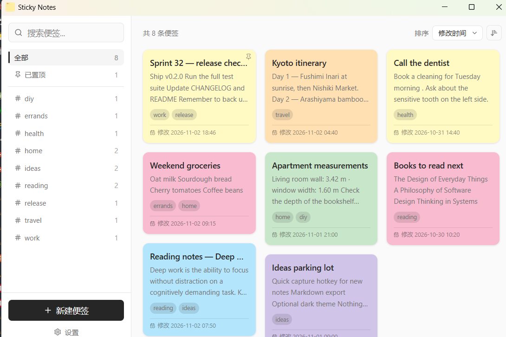
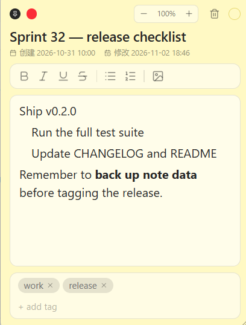
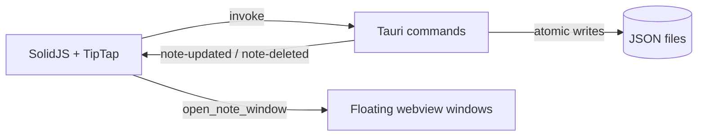

<div align="center">

# Sticky Notes 便签

**一款轻量、本地优先的 Windows 桌面便签应用。**

Tauri 2 · SolidJS · TipTap · Tailwind CSS 4

[English](README.md) · [简体中文](README.zh-CN.md)

[](https://github.com/Ricardo-Kaslana/sticky-notes/actions/workflows/ci.yml)
[](https://github.com/Ricardo-Kaslana/sticky-notes/releases)
[](LICENSE)
[](#环境要求)

[下载](https://github.com/Ricardo-Kaslana/sticky-notes/releases/latest) · [功能](#功能) · [从源码构建](#从源码构建) · [参与贡献](CONTRIBUTING.md)

</div>



Sticky Notes 让随手记下的想法始终触手可及：瀑布流管理页收纳所有便签，每条便签拥有独立的无边框浮窗。所有数据都以纯 JSON 保存在你自己的磁盘上——没有账号、没有云端、没有遥测。

> **项目状态：** 早期但可用。目前仅在 Windows 10/11 上验证过，界面为简体中文；英文界面已列入路线图。

---

## 功能

- **本地优先持久化** —— 每条便签一个 JSON 文件，存放在系统 app-data 目录。方便查看、备份或用版本控制管理。
- **瀑布流管理页** —— 搜索、带实时计数的标签筛选、仅看置顶，以及排序栏（修改时间 / 创建时间 / 标题，升降序）。
- **无边框便签浮窗** —— 任意位置拖动、任意边角缩放、窗口置顶，重新打开时恢复上次位置与尺寸。
- **富文本编辑** —— 基于 TipTap，支持标题、列表、粗体 / 斜体 / 下划线 / 删除线、链接与内嵌图片。
- **图片粘贴 / 拖放 / 工具栏插入** —— 附件复制到 app-data 目录，并通过 Tauri 受限的 asset 协议渲染。
- **自动保存** —— 编辑后防抖保存，间隔可配置；关闭窗口前会冲刷待保存内容。
- **六种马卡龙色** —— Paper、Blush、Sky、Sage、Apricot、Lavender，可按便签单独设置。
- **缩放** —— `Ctrl` `+` / `-` / `0`、标题栏缩放控件或 `Ctrl`+滚轮，范围 75%–200%。
- **标签** —— 从已有标签自动补全、大小写不敏感去重，并可在侧栏按标签筛选。
- **跨窗口同步** —— 浮窗中的编辑会立即反映到管理页。
- **系统托盘** —— 左键显示管理页；菜单可新建便签或退出应用。
- **隐私默认** —— 不发网络请求、不做分析、不后台同步。

---

## 下载

预编译的 Windows 安装包发布在 **[Releases](https://github.com/Ricardo-Kaslana/sticky-notes/releases)** 页面。

- 支持：**Windows 10 / 11 (x64)**。
- 构建产物**未签名**，首次运行时 Windows SmartScreen 可能提示风险。请确认下载来源为本仓库后选择“更多信息 → 仍要运行”，或自行从源码构建。
- 尚未实现自动更新。升级时请手动下载新版本；便签数据会保留。

---

## 环境要求

从源码构建需要：

- **Windows 10 / 11**
- **Node.js 18+**（推荐 22，见 `.nvmrc`）
- **Rust stable**（通过 [rustup](https://rustup.rs) 安装）
- **Microsoft C++ Build Tools**（Desktop development with C++）
- **WebView2 运行时** —— Windows 11 和较新的 Windows 10 已内置；否则请安装 Evergreen Runtime
- Tauri 完整依赖说明：<https://v2.tauri.app/start/prerequisites/>

macOS 与 Linux 未经验证。Rust 与 Tauri 代码或许能在这些平台编译，但托盘、窗口与自启动路径只在 Windows 上实际运行过。

---

## 从源码构建

```sh
git clone https://github.com/Ricardo-Kaslana/sticky-notes.git
cd sticky-notes
npm ci
npm run tauri dev
```

`npm run tauri dev` 会在 `http://localhost:1420` 启动 Vite、编译 Rust 后端并打开应用。前端改动热更新；Rust 改动会触发重新编译。

仅开发前端（没有 Tauri 后端，便签增删改会失败）：

```sh
npm run dev
```

### 验证

```sh
npx tsc --noEmit
npm test
cd src-tauri && cargo fmt --all -- --check && cargo clippy --all-targets -- -D warnings && cargo test
```

### 构建发布版本

```sh
npm run tauri build
```

安装包与独立可执行文件位于 `src-tauri/target/release/bundle/`。

---

## 使用

1. 从侧栏或托盘菜单新建一条便签。
2. 双击卡片打开便签浮窗。
3. 拖动标题栏或窗口空白处移动窗口；从任意边缘或角落缩放。
4. 编辑标题与正文、添加标签、切换颜色，或将窗口置顶。
5. 关闭浮窗即可保存，管理页会立即更新。
6. 默认情况下，关闭主窗口会隐藏到托盘。使用托盘菜单中的 **Quit** 退出应用；可在 **设置** 中修改此行为。



### 快捷键（便签浮窗）

| 快捷键 | 操作 |
|---|---|
| `Ctrl` `+` / `Ctrl` `=` | 放大 |
| `Ctrl` `-` | 缩小 |
| `Ctrl` `0` | 重置为 100% |
| `Ctrl` + 滚轮 | 放大 / 缩小 |
| `Ctrl` `B` / `I` / `U` | 粗体 / 斜体 / 下划线 |

---

## 数据与隐私

所有数据都留在本机。便签是 JSON 文件，设置文件与它们放在一起，附件按便签复制到独立目录。

| 数据 | 位置（Windows） |
|---|---|
| 便签 | `%APPDATA%\io.github.ricardo-kaslana.stickynotes\notes\<uuid>.json` |
| 设置 | `%APPDATA%\io.github.ricardo-kaslana.stickynotes\settings.json` |
| 附件 | `%APPDATA%\io.github.ricardo-kaslana.stickynotes\attachments\<note-uuid>\` |

**备份：** 复制整个 `io.github.ricardo-kaslana.stickynotes` 文件夹即可。没有导入/导出功能，也没有内置同步。

**升级：** v0.2.0 更改了应用标识。首次启动时，便签、附件与设置会自动从旧的 `com.dawnwang.stickynotes` 目录迁移过来（更早的安装还会从裸 `sticky-notes` 目录迁移），同时重写便签 JSON 中的附件绝对路径。如果数据很重要，请在切换版本前备份。

---

## 架构



| 层 | 选型 |
|---|---|
| 桌面外壳 | Tauri 2 |
| 后端 | Rust |
| 前端 | SolidJS 1.x + TypeScript |
| 编辑器 | TipTap 2（ProseMirror） |
| 样式 | Tailwind CSS 4 |
| 测试 | Vitest（前端）+ Cargo test（Rust） |

### 设计取舍

- **不用数据库。** 一条便签就是一个文件，用户无需工具即可阅读、复制和 diff。
- **一条便签一个窗口。** 每条便签是独立的 webview 窗口，同时打开多条不会阻塞管理页。
- **持久化与事件归后端所有。** 前端不直接写文件。Rust 原子写入并发出 `note-updated` / `note-deleted`，各窗口据此更新。
- **手写路由而非路由库。** Tauri 的 webview URL 处理在便签 ID 传递上不可靠，因此路由是 `src/index.tsx` 里的一小段 `Switch/Match`。

### 项目结构

```text
sticky-notes/
├── src-tauri/                 Rust 后端
│   ├── src/
│   │   ├── lib.rs             构建器、启动流程、旧数据迁移
│   │   ├── models.rs          Note、NotePosition、Settings
│   │   ├── commands/          notes / attachments / settings 命令
│   │   ├── windows.rs         便签浮窗生命周期
│   │   └── tray.rs            系统托盘
│   ├── capabilities/          Tauri 权限白名单
│   └── tauri.conf.json        标识、CSP、打包配置
├── src/                       SolidJS 前端
│   ├── routes/                MainView、NoteView
│   ├── components/            Sidebar、NoteCard、编辑器外壳、弹窗
│   ├── stores/                便签与设置状态
│   └── lib/                   类型化 IPC、事件、排序、筛选、缩放
├── docs/archive/              历史设计文档（非当前文档）
├── .github/workflows/         CI 与发布自动化
├── AGENTS.md                  AI 编码代理约定
└── CHANGELOG.md               版本记录（简体中文）
```

---

## 已知限制

- 实际仅支持 Windows；macOS/Linux 未验证。
- 只有浅色主题。
- 界面仅简体中文，尚未实现英文界面。
- 没有自动更新、同步或导入/导出。
- 安装包未签名。

这些限制记录在 [CHANGELOG.md](CHANGELOG.md) 与 [AGENTS.md](AGENTS.md) 中。欢迎提交改动来消除它们。

---

## 参与贡献

欢迎提交 Bug 报告、功能建议、文档修正和 Pull Request。请先阅读 [CONTRIBUTING.md](CONTRIBUTING.md)，并遵守[行为准则](CODE_OF_CONDUCT.md)。

- **安全问题：** 请勿公开提 Issue，参见 [SECURITY.md](SECURITY.md)。
- **AI 辅助贡献：** 修改代码前请阅读 [AGENTS.md](AGENTS.md) 中的硬性规则。

如果这个项目对你有用，点一个 Star 能帮助更多人发现它。

---

## 许可证

基于 [MIT License](LICENSE) 开源。Copyright © 2026 Dawn Wang。

## 致谢

使用 [Tauri](https://tauri.app)、[SolidJS](https://www.solidjs.com)、[TipTap](https://tiptap.dev)、[Tailwind CSS](https://tailwindcss.com) 与 [Lucide](https://lucide.dev) 构建。感谢这些项目的维护者。
